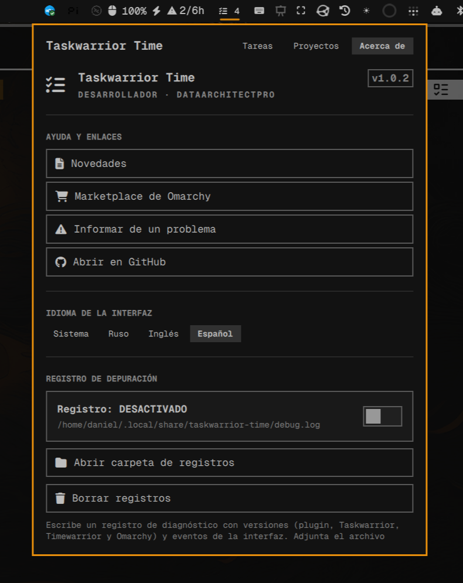

# Plugin About page reference

Use this when adding an About view or proposing one for a new plugin. Treat the screenshot and Taskwarrior Time implementation as a visual/structural reference, not as permission to reuse its branding or copy the whole page unchanged.

## Visual reference



The screenshot shows a compact, scrollable About view inside the plugin panel: existing panel navigation with About selected; a hero with icon, name, developer and version; separated sections for help links, interface language, and diagnostics. Rows use the panel's existing button language and theme. Orange border and dark surfaces belong to this captured theme—use installed semantic theme tokens, never sample or hardcode screenshot colors.

**Concept:** one in-panel destination for plugin identity, support links, and useful settings. **Wireframe:**

```text
┌ plugin name                         Tasks  Projects  About
│ [icon] Plugin name             [version]
│        Developer · Author
├ HELP & LINKS
│ [What's new] [Marketplace] [Report issue] [GitHub]
├ INTERFACE LANGUAGE
│ [System] [English] [Español]
├ OPTIONAL DIAGNOSTICS
│ [logging state / relevant actions]
└──────────────────────────────────────────────────────────
```

Keep only sections that fit the plugin's actual job. Identity and relevant help links form the core; language controls belong here only when the plugin supports an explicit language override; diagnostics belong only when the plugin has a real diagnostic feature.

## Taskwarrior Time source and copied QML

- [Upstream repository](https://github.com/DataArchitectPro/taskwarrior-time)
- [About view in `Panel.qml`](https://github.com/DataArchitectPro/taskwarrior-time/blob/master/Panel.qml)
- [Plugin README](https://github.com/DataArchitectPro/taskwarrior-time/blob/master/README.md)
- [Omarchy Marketplace listing](https://plugins.omarchy.org/plugin.html?id=taskwarrior-time)
- [Copy-and-adapt About QML template](about-page-template.qml)
- [MIT license notice](taskwarrior-time-MIT-LICENSE.txt)

The captured implementation was inspected in `/home/daniel/.config/omarchy/plugins/taskwarrior-time-dev-combined-235974/Panel.qml` (About view around lines 4103–4330). That local checkout had uncommitted changes; upstream `master` may differ, especially in translations. Check the target plugin and installed Omarchy version before using shell APIs.

The QML file is the copyable starter: copy its About `ColumnLayout` block into the new plugin's existing panel, then adapt it. It is not a standalone QML file; it depends on surrounding `root` properties/functions and installed `qs.Ui` components. Navigation buttons, `viewMode` routing, and IPC wiring sit outside the block and must be connected separately. The source is MIT-licensed; its full notice is kept alongside it.

## Implementation pattern

- Start from `about-page-template.qml`, insert the About block as a state/view in the existing panel, then preserve that panel's open/close and keyboard behavior. Taskwarrior Time switches `viewMode` to `about`; it does not start another Quickshell process or declare a second plugin kind.
- Make long content scroll inside the panel (`Flickable` with content height bound to the body). Use the current shell's layout, spacing, semantic colors, and `qs.Ui` components after verifying their installed API.
- Organize information with a hero, dividers, section headings, and full-width action rows. Keep version, author, and links sourced from one maintainable place; avoid introducing duplicate hardcoded metadata.
- Open only fixed, trusted project URLs through the shell-supported external-link API. Localize all visible labels through the plugin's translator; see [i18n guidance](i18n.md).
- Reuse the reference's language selector only when a persisted override is useful. Prefer the plugin/host's existing settings mechanism; don't add a helper process solely to store a locale.
- Copy diagnostics controls only when equivalent actions exist and their permissions/side effects are documented. Do not expose unrelated paths or actions merely to fill space.
- Replace Taskwarrior's name, author, version, URLs, and icons with the new plugin's own metadata and Omarchy icon provider. Keep the visual hierarchy, not the other plugin's identity.

Before finishing, replace all Taskwarrior-specific bindings and values: connect the About navigation/routing; supply the new plugin's metadata, localized keys, URLs, and working actions; remove language/debug controls the plugin does not support. Verify each `qs.Ui` component against the installed shell. Then inspect a runtime screenshot at target panel scale and compare it with the reference; check scrolling, selected navigation state, keyboard focus/close behavior, long translated labels, and theme adaptation.
